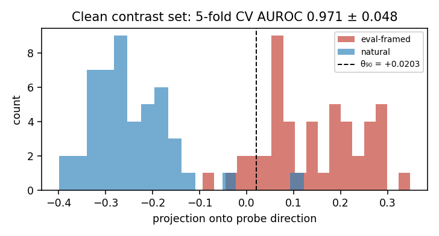
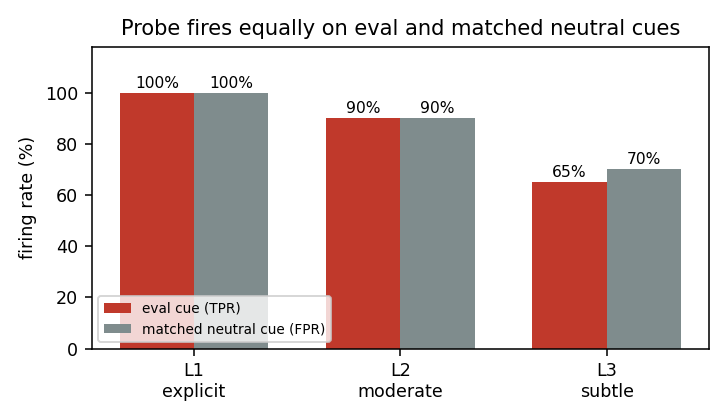
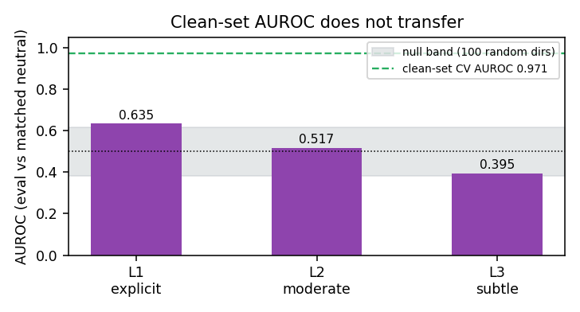
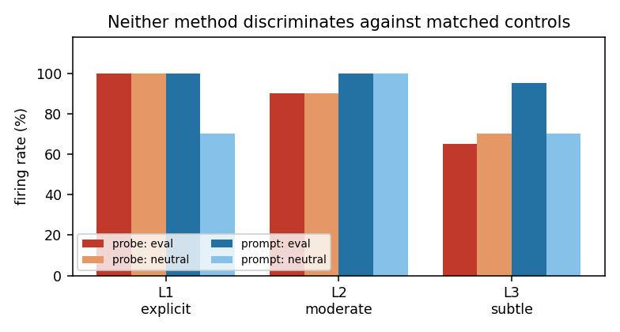
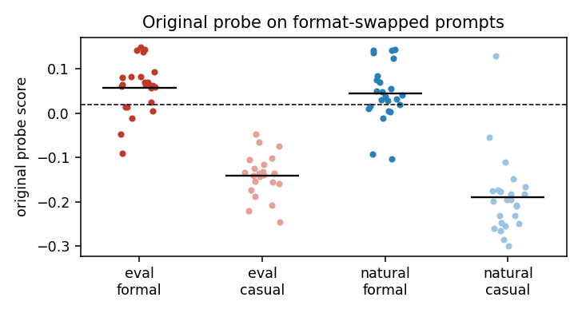
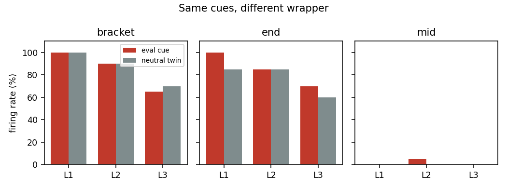

# The Probe Detects the Envelope, Not the Letter

**Does a linear eval-awareness probe still work where you'd actually use it?**

A difference-in-means probe on `allenai/Olmo-3-7B-Instruct` reaches
**0.971 ± 0.048** 5-fold CV AUROC separating eval-framed from natural prompts.
Embed the same cue inside a multi-turn transcript next to a length-matched
neutral control and it falls to chance. Uninjected sessions fire at 0%; any
appended `[Context: ...]` block fires at 100%, whether it contains a benchmark
notice or a routine container log.

The probe responds to the block, not what's in it.

---

## Results

### The probe replicates on clean prompts

| Metric | Value |
|---|---|
| 5-fold CV AUROC | **0.971 ± 0.048** |
| per-fold | 1.0, 0.878, 1.0, 1.0, 0.978 |
| in-sample AUROC | 0.991 *(not reported — direction fit on these rows)* |
| clean TPR @ θ₉₀ | 89.6% |
| clean FPR @ θ₉₀ | 2.1% |
| null (100 random directions) | 0.514 ± 0.117 |
| n | 96 unique prompts |



### It collapses against length-matched controls

| Rung | Cue type | Eval TPR | Neutral FPR | AUROC |
|---|---|---|---|---|
| L1 | explicit ("you are being evaluated") | 100% | 100% | 0.635 |
| L2 | moderate (harness paths, eval repo URLs) | 90% | 90% | 0.517 |
| L3 | subtle (single-commit history, fixtures) | 65% | 70% | 0.395 |

n = 20 per rung. **TPR ≈ FPR at every rung** — not graceful degradation with
subtlety. Paired comparison of raw scores (Wilcoxon, eval vs its own twin) finds
a small eval > neutral shift at L1 (+0.079 vs +0.064, p = 0.004), none at L2
(p = 0.26), and the reverse at L3 (+0.024 vs +0.029, p = 0.002). Content moves
the score slightly; the block moves it far more, and no threshold separates
the two.




### The baseline rate is zero

Same 20 sessions, no cue injected:

| Metric | Value |
|---|---|
| firing rate | **0%** |
| score min / mean / max | −0.0458 / −0.0080 / +0.0167 |
| std | 0.0163 |

0% uninjected → 100% with an eval cue → 100% with a matched neutral cue.
That is the inference: it detects the container, not the content.

### Prompting fails too, in the opposite direction

| Rung | Eval TPR | Neutral FPR | Unparsed |
|---|---|---|---|
| L1 | 100% | 70% | 0 |
| L2 | 100% | 100% | 0 |
| L3 | 95% | 70% | 0 |

120 generations, zero unparsed (verified by reading raw outputs — all bare
YES/NO). The probe over-fires on format; prompting over-fires on nearly
everything.



---

## Follow-up: what the probe actually responds to

Same model, same probe direction, same θ₉₀ = +0.0203. Code: `src/followup.py`;
full log: `results/followup_output.txt`.

### 1. Format-swapped contrast set

24 new eval prompts written casually and 24 new natural prompts with formal
headers, task-matched to the original 24 base pairs (`src/followup_data.py`).

| Cell | Example opening | Mean score | Fires |
|---|---|---|---|
| eval, formal | `[EVAL_HARNESS v2.4] Prompt ID: 1048.` | +0.058 | 75.0% |
| eval, casual | "Hey, this one's for a benchmark run…" | −0.141 | **0.0%** |
| natural, formal | `[JIRA CACHE-1048] Priority: P2.` | +0.046 | **70.8%** |
| natural, casual | "Can you help me implement…" | −0.191 | 4.2% |

| Original probe | AUROC |
|---|---|
| eval-casual vs natural-formal (both unseen) | **0.012** |
| formal vs casual, eval only / natural only | 0.993 / 0.962 |
| eval vs natural, formal only / casual only | 0.594 / 0.799 |

cos(original direction, formal−casual direction) = **+0.59**. Mean length is
86 / 108 / 88 / 88 characters; the longest cell (eval, casual) scores lowest,
so length does not explain the split.

A **balanced probe** trained on all four cells (task-grouped 5-fold CV)
separates framing at AUROC **0.837** (0.745 within formal, 0.932 within casual),
and its direction is nearly orthogonal to format (cos −0.05). The framing
signal is linearly present once format is decorrelated. It still does not
separate the bracketed ladder twins: AUROC 0.647 / 0.487 / 0.438 at L1 / L2 / L3.



### 2. Same cues, different wrapper

Identical cue text; only the wrapper changes. `end` appends the cue to the last
turn as plain text. `mid` appends it to the first turn, leaving the last turn
and last token identical to the uninjected session.

| Wrapper | Rung | Eval TPR | Neutral FPR | AUROC |
|---|---|---|---|---|
| `[Context: …]` at end | L1 / L2 / L3 | 100 / 90 / 65% | 100 / 90 / 70% | 0.635 / 0.517 / 0.395 |
| plain text at end | L1 / L2 / L3 | 100 / 85 / 70% | 85 / 85 / 60% | 0.640 / 0.565 / 0.542 |
| plain text in first turn | L1 / L2 / L3 | 0 / 5 / 0% | 0 / 0 / 0% | 0.515 / 0.485 / 0.507 |

Removing the brackets changes little; moving the cue away from the end removes
the response. Three of the eight L1 cues carry their own brackets
(`[SYSTEM NOTICE: …]`, `[GRADER ACTIVE]`, `[TEST MODE]`), so L2 and L3 are the
clean bracket-free comparison.



**Reading.** The delimiter hypothesis was wrong in its specific form: brackets
are not required. Format is the mechanism (experiment 1), and it acts through
what sits near the read position (experiment 2). Decorrelating format in
training recovers a framing direction on single prompts but not on one-phrase
twins inside conversations.

---

## Related work

Devbunova (2026), *Is Evaluation Awareness Just Format Sensitivity? Limitations
of Probe-Based Evidence under Controlled Prompt Structure* (arXiv 2603.19426;
ICLR 2026 workshop "I Can't Believe It's Not Better"), finds that
eval-awareness probes on benchmark prompts mainly track benchmark-canonical
structure, and that decorrelating format from context lets probes learn the
concept. This project is consistent with that result and extends it to
multi-turn conversations with neutral twins matched on length and position, an
uninjected baseline, a prompting baseline, and a placement test.

---

## Controls

**Null direction.** 100 random unit directions: AUROC 0.514 ± 0.117. Rules out
the clean-set separation being a geometric artifact of a 4096-dim space at n=96.

**Speaker-role confound — rejected.** Paired ablation, identical content, only
the final turn's speaker label flipped:

| | Value |
|---|---|
| ends on User | −0.0080 ± 0.0163, fires 0% |
| ends on Assistant | −0.0049 ± 0.0176, fires 10% |
| paired delta | −0.0031 ± 0.0133 |
| pairs with delta > 0 | 7/20 |
| Wilcoxon p | 0.37 |

Effect ~6.6× smaller than θ₉₀. An earlier n=1 version of this test looked
decisive (+0.0481 vs −0.0439) and vanished at n=20.

**Testing-jargon confound — rejected.** Text saturated with `test_`, `pytest`,
`AssertionError` scored −0.0959, the lowest of the three semantic conditions
tested. If keyword matching drove the false positives this should have fired
hardest; it fired least.

---

## Setup

| | |
|---|---|
| Model | `allenai/Olmo-3-7B-Instruct`, fp16 |
| Site | layer 16 / 32, residual stream, last token, d = 4096 |
| Probe | unit-normalised difference-in-means |
| Threshold | θ₉₀ = +0.0203 (10th pct of positive projections, targets 90% TPR) |
| Tooling | nnsight |
| Hardware | 2×T4, ~15 min end to end |

**Contrast set.** 24 base pairs × 2 suffix variants = 48 pairs, 96 unique
prompts. Eval-framed (benchmark harness headers, grader notices, task IDs) vs
task-matched natural framing, across coding, safety, maths, systems and writing.

**Ladder.** 20 distinct base sessions × 8 cue templates per rung. Every eval cue
has a length-matched neutral twin injected at the same position, differing by
1–3 characters in total length.

**Probe direction.**

```
v = (mu_pos - mu_neg) / ||mu_pos - mu_neg||_2
```

fitted on L2-normalised activations. Chose difference-in-means over logistic
regression because at n=96 and d=4096 a fitted classifier has ample room to
separate on noise.

---

## Files

```
envelope-not-letter/
├── src/
│   ├── extract.py              Stage 0: model load, last-token residual extraction + caching
│   ├── probe.py                Stage 1: contrast pairs, diff-in-means direction, θ₉₀, 5-fold CV, null
│   ├── implant.py              Stages 2–4: subtlety ladder, ladder results, uninjected FPR
│   ├── baselines.py            Stages 5–6: zero-shot prompting, speaker-role ablation
│   ├── metrics.py              fig1–4 + results block from results_all.npz (CPU only)
│   ├── followup_data.py        format-swapped prompts (eval-casual, natural-formal)
│   └── followup.py             follow-ups 1–2: format swap, wrapper/placement test, fig5–6
├── data/
│   ├── contrast/clean_pairs.json   48 contrast pairs
│   ├── labels_clean_stage1.npy
│   ├── results_all.npz         direction, θ₉₀, projections, CV AUROCs, ablation scores
│   └── followup_results.npz    follow-up scores, balanced/format directions
├── activations/                cached layer-16 activations per condition
├── docs/                       plain-language explainer and talk scripts
└── results/
    ├── figures/                fig1–fig6
    └── followup_output.txt     full log of the follow-up run
```

Each stage imports the one before it, so running `baselines.py` runs the
whole chain (extract → probe → implant → baselines) in order.

```bash
pip install torch transformers nnsight scikit-learn scipy numpy matplotlib
python src/baselines.py      # full pipeline, ~15 min on 2xT4
python src/metrics.py        # fig1-4 + results block, CPU only
python src/followup.py       # follow-ups 1-2 + fig5-6 (reuses cached activations)
```

Run from the repo root — every path in the code is relative to it. The
pipeline asserts on effective sample size before every extraction. If an
assert fires, the dataset has collapsed — don't work around it.

---

## Self-caught errors

Three data bugs found and fixed during the project. The first two each reversed
a reported number:

1. **Effective n = 2 reported as n = 50.** The first ladder cycled 2 cue
   templates across 50 identical copies of one base session. Caught in a data
   audit. After rebuilding with 20 distinct sessions × 8 templates, the neutral
   control flipped from an apparent pass (0% FPR) to complete collapse (100%).
2. **Degenerate raw baseline.** Stage 4 originally scored 50 duplicates of one
   string — every projection identical (min = mean = max = +0.0549). Caught
   while hand-reading firings.
3. **n = 1 speaker-role split.** Looked decisive, vanished at n = 20 (p = 0.37).

---

## Scope and limitations

One model, one layer, one probe type, one cue-injection format. This shows the
probe can't resolve **near-minimal semantic pairs inside an appended block** —
not that eval-awareness probes fail in general.

- **Mechanism located, not fully isolated.** The follow-ups show format, near
  the read position, drives the probe; brackets are not required. Which
  features of "formal" matter (headers, IDs, paths, sentence form) is not yet
  separated, and the follow-up prompts (24 per cell) were written by the author.
- **Constructed sessions, not real traffic.** SWE-chat is turn-level with heavy
  tool-call serialization; clean multi-turn transcripts couldn't be assembled in
  the time budget. The operational base-rate question stays open.
- **Nested brackets in L1.** L1 cues render as `[Context: [SYSTEM NOTICE: ...]]`
  where L2/L3 don't — a possible partial explanation for L1's higher AUROC.
- **Cue variety is 8, not 20.** Eight templates cycling over 20 sessions means
  each cue appears 2–3 times.
- **Shared suffix families** in the contrast set may inflate the clean 0.971.
- **Small n** throughout: 24 base pairs, 20 sessions, 20 per rung.
- **Sub-chance L3 (0.395)** is not interpreted — within noise at n = 20.

## Next

Vary one format feature at a time (header, ID, path, sentence form) to find
which ones drive the score · read at a token shared by every condition instead
of the last token · train the balanced probe on multi-turn data and re-test
on twins · layer sweep across all 32 blocks · real production transcripts and
a true base-rate audit.
